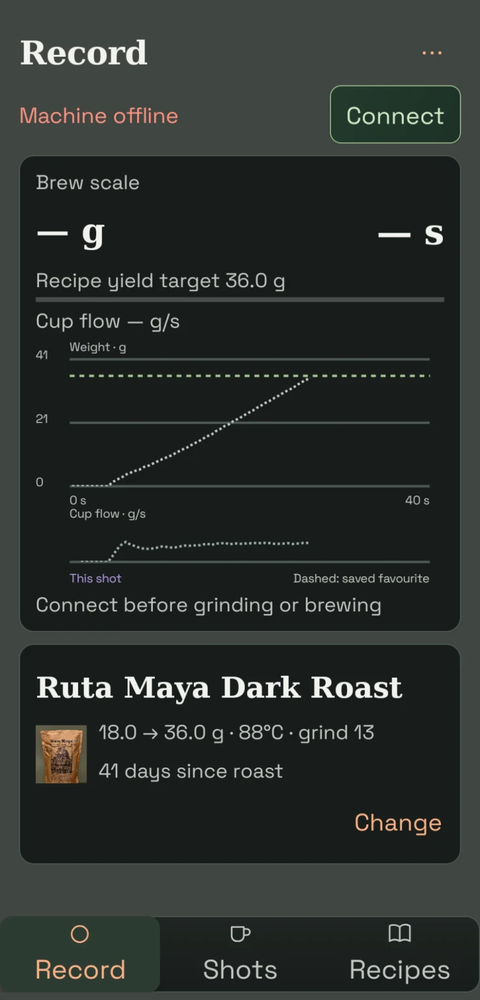
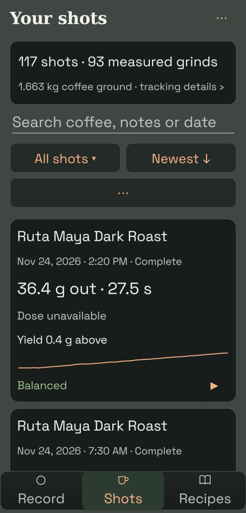
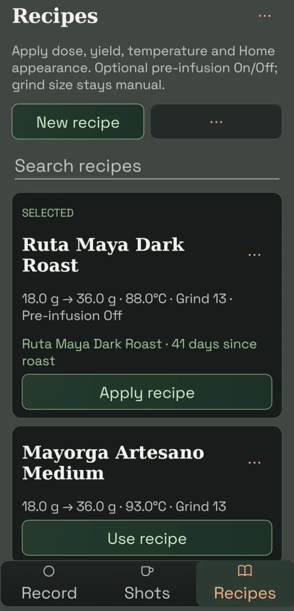
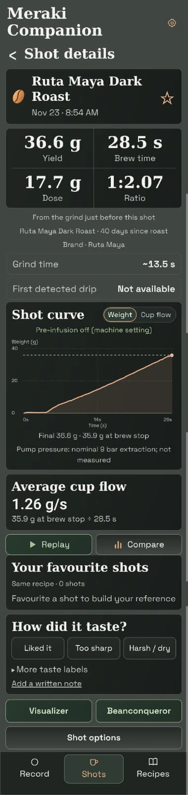
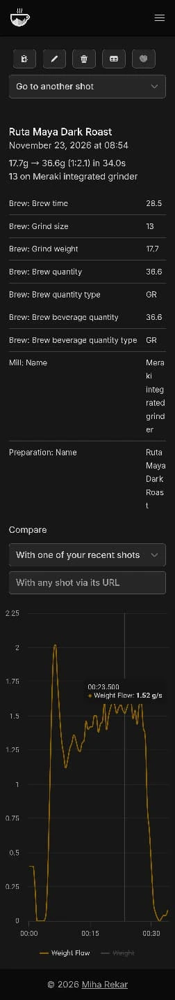
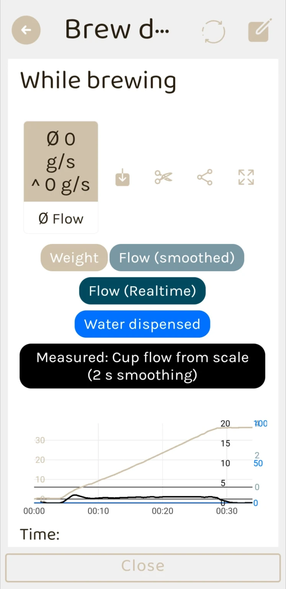
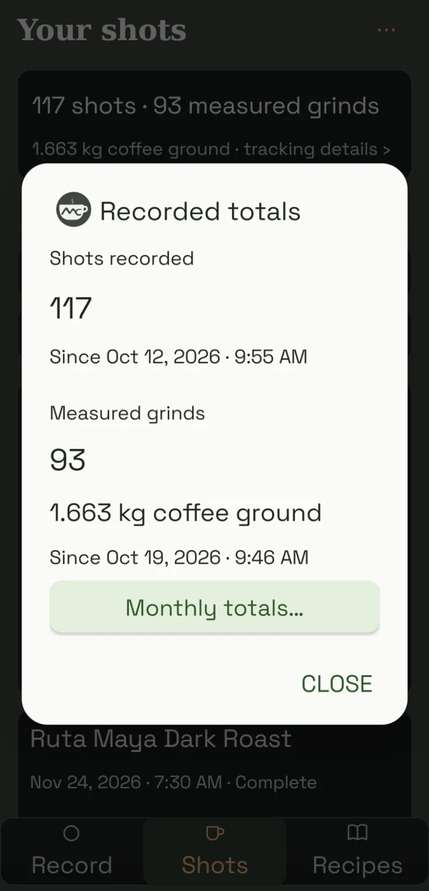
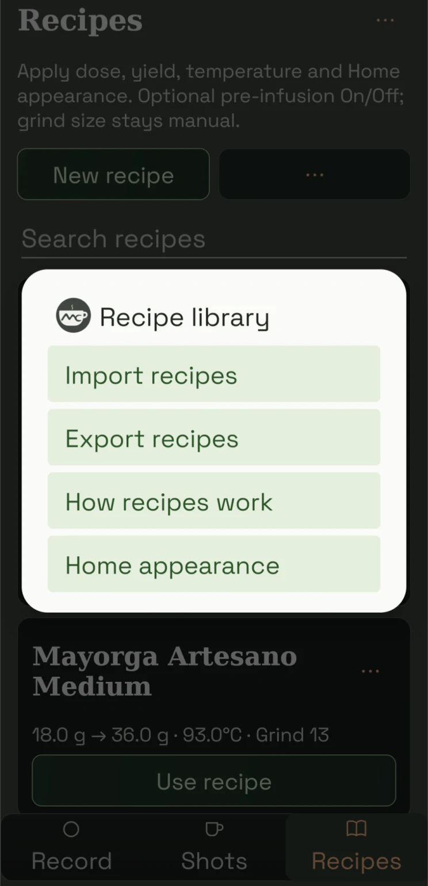
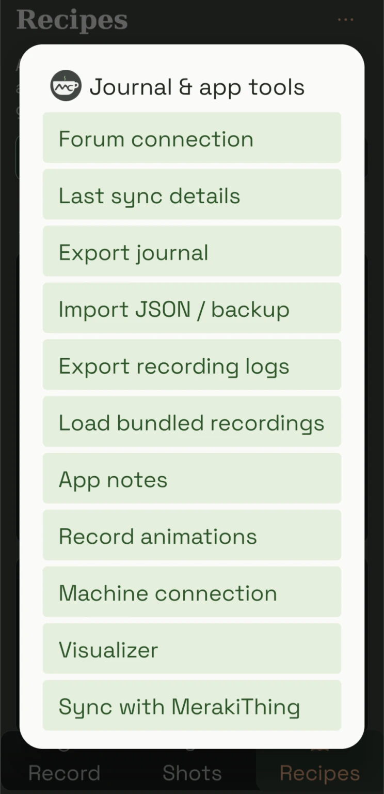

# Meraki Companion

  

  
  
  
  

**Meraki Companion** is an independent Android app for Meraki espresso owners. Follow an extraction as it happens, replay and compare your shots, and keep the recipe and tasting notes together so you can dial in your next cup.

  
  
  

Record · Shot journal · Recipe library

## Contents

- [Features](#features)
- [Requirements](#requirements)
- [Quick start](#quick-start)
- [Using Companion](#using-companion)
- [Visualizer and Beanconqueror](#visualizer-and-beanconqueror)
- [More screenshots](#more-screenshots)
- [Machine setup and recovery](#machine-setup-and-recovery)
- [Troubleshooting](#troubleshooting)
- [Related development](#related-development)
- [Development and feedback](#development-and-feedback)
- [License](#license)
- [Disclaimer](#disclaimer)

## Features

| Area | What you can do |
| --- | --- |
| **Live recording** | Follow grind and brew weight, elapsed time, and calculated cup flow. Save the shot and final yield. |
| **Shot journal** | Review graphs and tasting notes, mark favourites, replay an extraction, and compare recent shots. |
| **Recipes** | Save dose, yield, brew temperature, grind setting, and a target time window. Apply supported settings with an existing compatible machine setup. |
| **Beans and usage** | Track bean bags, roast and opening dates, brand assignments, and measured grind totals. |
| **Backups and sharing** | Back up or import your journal, export shots for Visualizer, and send compatible shots to Beanconqueror. |

See the [full feature reference](docs/FEATURES.md) for details, optional integrations, and limits.

## Requirements

| To do this | You need |
| --- | --- |
| **Build the preview** | Android Studio, Android SDK Platform 35, and a JDK 25 Gradle runtime. See the [build instructions](android/README.md#build). |
| **Run the app** | Android 8.0 or newer. An emulator works for offline features. |
| **Record live** | An existing compatible Secure Link service on the espresso machine, a pairing code, and the phone and machine on the same local Wi-Fi. |
| **Apply recipe settings** | A paired machine with the corresponding settings service enabled. |

## Quick start

1. Open [`android/`](android/) in Android Studio, sync Gradle, and build the debug variant. The [Android notes](android/README.md#build) include the terminal command.
2. Open **Recipes** to create your first recipe. If you already have compatible shot or journal JSON, open **Journal & app tools** to import it and try the graphs and replay.
3. If your machine already has a compatible Secure Link setup, open **Machine connection** and scan its pairing QR code. Then open **Record** and pull a shot.

The preview is distributed as Android source. Back up your journal before replacing an existing installation. See the [signing and installation notes](android/README.md#build) if you already have Companion on your phone.

## Using Companion

| I want to… | Where to go |
| --- | --- |
| Follow a live shot | **Record** |
| Replay a pull or write tasting notes | **Shots** → open the shot |
| Compare recent pulls | **Shots** → open the recipe comparison |
| Save a recipe for tomorrow | **Recipes** → create or edit a recipe |
| Export or import a journal | **⋯** → **Journal & app tools** |
| Pair or update the machine connection | **⋯** → **Machine connection** |

## Visualizer and Beanconqueror

Open an eligible complete shot from **Shots** and choose a destination in the shot detail view.

| Destination | What you can do |
| --- | --- |
| **Visualizer** | Save a Visualizer JSON file with the recorded graph and available shot settings. Direct upload is available in developer builds configured with a [registered Visualizer client ID](android/README.md#build). You review and confirm the upload in Companion. |
| **Beanconqueror** | Send the shot directly to the Beanconqueror Android app (8.8.2 or later). Review the transfer and match the bean, grinder, and preparation method before sending. |

See the [Visualizer](docs/FEATURES.md#visualizer) and [Beanconqueror](docs/FEATURES.md#beanconqueror) sections for the data each transfer includes.

  
  
  

Companion shot details · Visualizer shot page · Beanconqueror brew graph

See the [Beanconqueror overview](docs/screenshots/beanconqueror-overview.webp) and [imported brew settings](docs/screenshots/beanconqueror-brew-settings.webp) for the same example.

## More screenshots

  
  
  

Recorded totals · Recipe import and export · Journal tools

[View the full recipe editor](docs/screenshots/recipe-editor.webp) for dose, yield, brew temperature, pre-infusion, the target time window, and bean bag settings.

## Machine setup and recovery

Companion’s optional machine integration adds a background service and makes a reversible startup change. It preserves the original Meraki display executable and MCU firmware.

The Mac Self Service Installer 0.5.0 is a separate owner-test package. Fresh machine setup, the updated repair-removal preview, and cleanup for older test installations remain **TBD** for public distribution. This preview’s live recording was tested using an existing compatible installation.

## Troubleshooting

**The machine won’t connect.** Check that the phone and espresso machine are on the same local Wi-Fi. Open **Machine connection** to check the saved address or to pair again using your machine’s current code.

**I want to try the app without pairing.** The recipe library and local journal work offline. Import a compatible shot file to try the detail graphs and replay.

**I can export for Visualizer, but direct sign-in is unavailable.** Export is available by default. Direct sign-in uses a developer’s own registered client ID. See the [Android build notes](android/README.md#build).

## Related development

- **Home Assistant:** A separate dashboard prototype is in development for live recording, exploring saved shots, and comparing weight curves. It can import compatible Companion recipe backups. The prototype reads machine data and runs separately from this Android preview.
- **MerakiThing:** Companion can optionally sync shots and recipes over a paired local connection. Development of the separate MerakiThing project continues. See the [sync details](docs/FEATURES.md#merakithing-shot-and-recipe-sync).

## Development and feedback

Start with the [Android build and test notes](android/README.md) and the [changelog](CHANGELOG.md). The owner-tested Pixel build preserved the existing journal, recipes, bags, and measured grind totals during an update, and recorded a new espresso shot. The test notes include emulator checks and optional integration results.

For a GitHub issue, include the Companion version, Android version, and what you expected to happen. For a live-connection issue, include the machine model and firmware versions if known. Keep pairing credentials and private journal data out of reports.

## License

Companion’s original source is licensed under the [Mozilla Public License 2.0](LICENSE). Third-party dependencies and fonts retain their own terms.

## Disclaimer

> [!WARNING]
> **Read this before connecting Companion to an espresso machine.** Companion is experimental community software. It can apply supported recipe settings when connected to a compatible machine service. Keep the machine’s own controls available and check its settings before brewing.

- **Know what this preview includes.** This is an Android source release with build instructions. The shot journal and recipe library can be used offline. Live recording requires an existing compatible Secure Link installation. The Mac machine installer remains an owner-test package. See [Machine setup and recovery](#machine-setup-and-recovery) for the status of fresh setup and cleanup.
- **Know what changes on the machine.** Companion’s optional machine integration adds a background service and makes a reversible startup change. It preserves the original Meraki display executable and MCU firmware. Applying a recipe can change supported settings on a paired machine. Verify the settings on the machine before using them.
- **Respect heat, pressure, and electrical hazards.** Follow the manufacturer’s operating and service instructions. Keep the enclosure closed during ordinary setup and use. If a fault requires internal access, stop and contact a qualified technician.
- **Prepare for data loss or recovery.** Export the journal and recipes you want to keep before changing builds. Keep any machine recovery backup private and available before attempting machine-side changes. Incompatible software, interrupted updates, or storage failure can leave a setup unusable. Recovery and data preservation are not guaranteed.
- **Understand the readings.** Shot timing, dose, and yield depend on the readings received. Cup flow is calculated from scale weight. Nominal pressure and pre-infusion settings are not measured pressure curves. Use the graphs as brewing aids and use the manufacturer’s procedures for safety checks.
- **Protect pairing and network access.** Pair only with equipment you own or administer. Use a trusted local network and keep pairing QR codes, keys, and backups private. Keep machine services off the public internet. Review what you share with third-party services, including any tasting notes.
- **Check compatibility after an update.** Android builds, machine firmware, and machine-side services can change independently. Check the [documented test combinations](android/README.md#review-status) and verify basic operation before relying on live recording or recipe application after an update.
- **Check your warranty and service terms.** Ask the seller or manufacturer how third-party software may affect service for your machine. Describe your setup accurately if you request service. Rights protected by applicable law remain in effect.
- **Independent project and third-party rights.** Rotary Pumpers develops Companion independently of MerakiTech. Product names identify equipment and integrations. The release does not distribute manufacturer firmware. Third-party components retain their own licenses. Follow applicable laws and license terms.
- **Warranty, liability, and support.** The software is provided as is under the [Mozilla Public License 2.0](LICENSE). See sections 6 and 7 for the warranty disclaimer and liability limits. Individual support, future compatibility, and recovery are not guaranteed.
